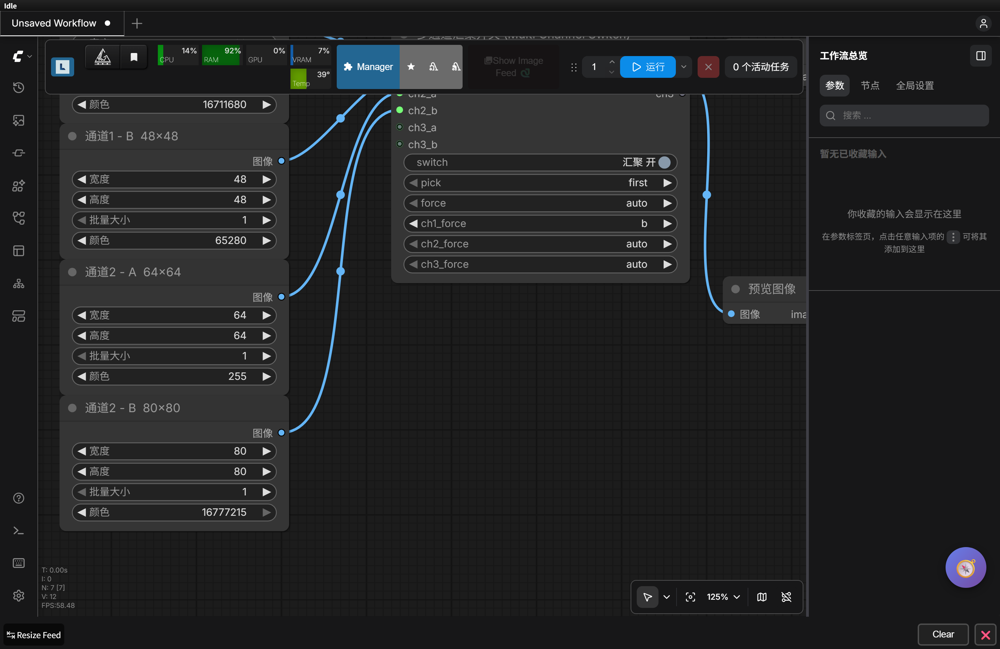
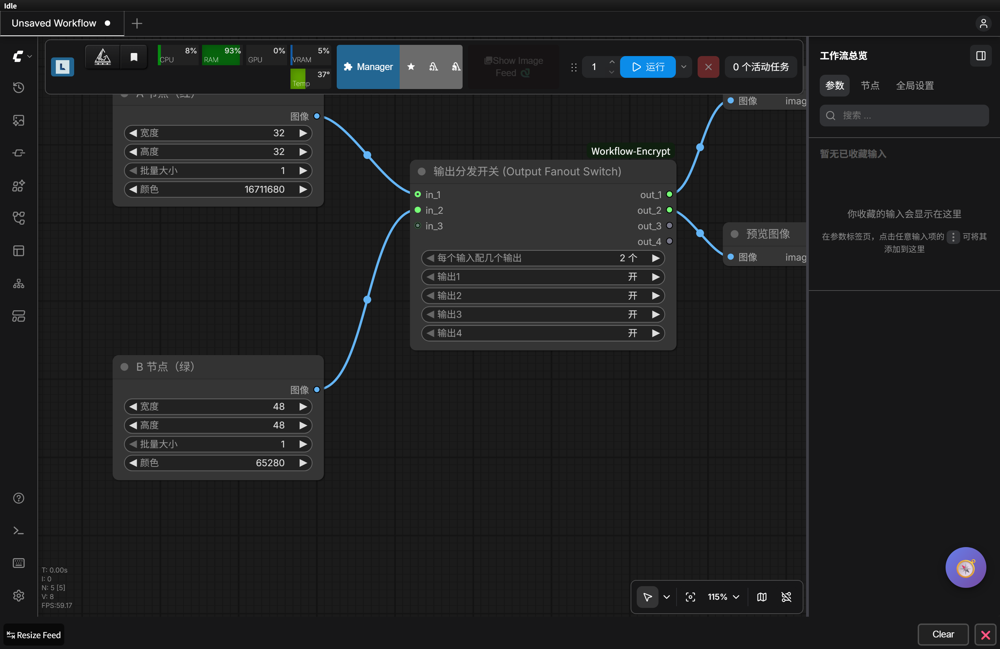
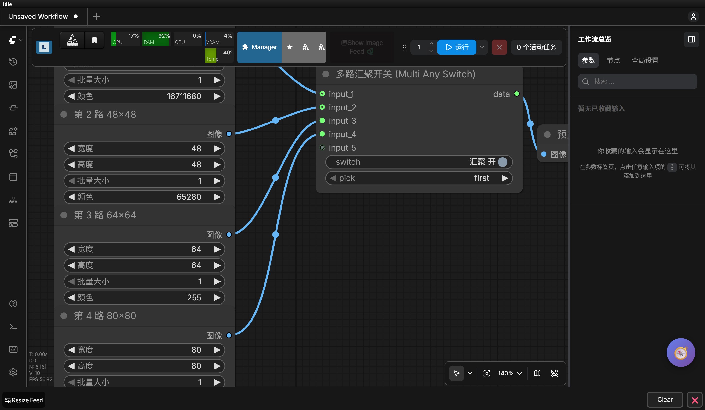

**English** ｜ [中文](README.md)

# Mute Bypass / Multi Collect Switch (Mute Bypass Switch)

A small set of switches for ComfyUI: **once the upstream node is muted / disabled (Mute, Ctrl+M), the data still flows through** —
and what comes out is the original object: no copy, no conversion, no detach, no shuffling to CPU, not a single byte altered.

Five nodes in total:

| Node | What it does |
|---|---|
| **Multi Channel Switch** (多通道汇聚开关) — recommended when one branch produces several things | each channel picks "whichever of its paths is alive" on its own, **the channel count grows by itself** (+2 inputs / +1 output), up to 8 channels |
| **Multi Any Switch** (多路汇聚开关) — recommended when you only need one stream | **wire as many paths as you like** (input slots grow themselves), outputs whichever path has a value |
| **Output Fanout Switch** (输出分发开关) — the reverse of multi-channel: one-to-many | one input paired with several outputs (2/3/4 selectable), each output toggled on its own, output slots appear and disappear automatically |
| Mute Bypass Switch (静音旁路开关) | two paths, main / bypass; when main is muted it goes down bypass automatically |
| Any A/B Switch (任意 A/B 开关) | any type, pick one of two |

> Only want to install one and remember one rule:
> a branch that produces one thing → use the Multi Any Switch; a branch that produces several things (image + mask + conditioning…) → use the Multi Channel Switch.

What the Multi Channel Switch actually looks like (channels 1 and 2 fully wired, channel 3 grown automatically):



What the Output Fanout Switch actually looks like (two inputs A/B → 4 outputs, with `out_1` and `out_3` each wired to a preview):



What the Multi Any Switch actually looks like (all 4 paths wired, a 5th empty slot has appeared on its own):



> **Install**: drop the whole `ComfyUI-MuteBypassSwitch` folder into `ComfyUI\custom_nodes\`
> (`git clone https://github.com/Davonez/ComfyUI-MuteBypassSwitch.git` inside `custom_nodes` works too),
> restart ComfyUI, then hit `F5` in the browser once and the nodes are in the menu
> (category `Switch`; searching `汇聚` / `Mute` / `Multi` finds them). The longer walkthrough is in [INSTALL.txt](INSTALL.txt).

---

## 1. Why the original setup deadlocks (the root cause)

ComfyUI's "mute" doesn't skip a node at run time — it **keeps the node out of the execution graph altogether**.
The wire on its output side disappears with it when the prompt is submitted. So nothing feeds the downstream node's input any more:

* if that downstream input is **required** → the engine declares the whole job invalid, throws an error, and not one node runs:

  ```
  Required input is missing
  ```

* if that downstream input is **optional** → the engine quietly skips it and the node runs anyway (minus the data, so the result may well be wrong).

Both rules are right there in the engine source (on this machine: `validate_inputs` in `ComfyUI/execution.py`):

```python
if x not in inputs:
    if input_category == "required":
        ...
        "message": "Required input is missing",  # required input missing -> the whole job fails
    continue                                     # optional input missing -> skipped silently
```

So "mute a node in the middle → the downstream node errors out and everything stalls" is built-in engine behaviour, not a bug in some plugin.
**There is exactly one way out: put a node in front of that required downstream input that can always hand out a value.**

This plugin is that node. Both of its inputs are declared **optional + any type `*`**, so:

1. the upstream node is muted → this node doesn't error out over a missing input (optional input, the engine waves it through);
2. main has no value → this node hands the data arriving on the **bypass** path straight on to the downstream node.

The `*` wildcard is the engine's own Any type (in `comfy_execution/validation.py`, `IO.AnyType.io_type == "*"` is let straight through),
so IMAGE / LATENT / CONDITIONING / MODEL / CLIP / VAE / MASK / strings / numbers… all connect, and you don't need a separate switch per type.

---

## 2. How to wire it (following the diagram you drew)

```
             ┌────────────────────────────────┐
  upstream ─►│  some node (the one you mute)  │──────┐ main
     │       └────────────────────────────────┘      │
     │                                               ▼
     │                                    ┌──────────────────────┐
     └───────────────────────────────────►│  Mute Bypass Switch  │──────► downstream
                bypass                    │  switch = bypass on  │   (required input here)
                                          └──────────────────────┘
```

Three steps:

1. take the **upstream** node's output (Load Image, your LoRA node, some post-processing node) and pull two wires:
   one into the node that gets muted, one into the switch's `bypass`;
2. the **muted node**'s output → the switch's `main`;
3. the switch's output `data` → the interface the **downstream node** had before.

In normal use: `main` has a value, the switch hands `main` over untouched — the same as having the wire directly connected, behaviour completely unchanged.
When you mute it: the `main` wire is gone, the switch reroutes to `bypass` automatically and gives the downstream node the upstream's original data, so the workflow keeps running.

---

## 3. Node parameters

### Mute Bypass Switch (静音旁路开关)

| Parameter | Type | Description |
|---|---|---|
| `main` | input, **optional**, any type | main path: from the node you might mute |
| `bypass` | input, **optional**, any type | bypass: the path that takes over when main fails (usually wired straight to the upstream source) |
| `switch` | toggle, default **bypass on** | on: allow the bypass when main is missing; off: main only (same as cutting the bypass wire) |
| `route` | dropdown, default `auto` | `auto` main first, bypass when it's missing ／ `main` main only ／ `bypass` bypass only (for debugging) |
| `data` | output, any type | the object that came in, passed through as-is (same reference) |

The full `route` behaviour table:

| main | bypass | switch | route | output |
|---|---|---|---|---|
| has value | has / none | any | `auto` | **main** (original object) |
| empty | has value | on | `auto` | **bypass** (original object) ← this is the "still passes through when muted" case |
| empty | has value | off | `auto` | empty (back to normal, downstream still gets nothing) |
| empty | empty | any | `auto` | empty + a console warning |
| has value | has value | any | `main` | main |
| empty | has value | any | `main` | empty (respects "main only") |
| has value | has value | any | `bypass` | bypass |
| has value | empty | any | `bypass` | falls back to main (never blocks) |

> Note that "falsy values" like `0` / `""` / `False` still count as **having a value** — they are never mistaken for missing.

### Any A/B Switch (任意 A/B 开关)

A generic two-way pick thrown in for convenience: two any-type inputs `a` / `b`, `which` picks A or B,
and the selected path is output as-is; if the selected path isn't connected it falls back to the other one. Handy for A/B comparisons and temporary bypasses.

### Multi Any Switch (多路汇聚开关)

Wire as many paths as you like — several any-type inputs collect into one, and it **outputs whichever of them has a value**.

```
path 1 ──┐
path 2 ──┤
path 3 ──┼──►[ Multi Any Switch ]──► data ──► downstream
path 4 ──┤     (picks the one with a value)
path N ──┘
```

| Parameter | Type | Description |
|---|---|---|
| `input_1` / `input_2` … | input, **optional**, any type | path N goes into slot N. **As soon as the last path is wired, one more empty slot appears** and you can keep adding (up to 32 paths) |
| `switch` | toggle, default **collect on** | on: pick whichever of the paths has a value; off: only path 1 counts (same as not having this node) |
| `pick` | dropdown, default `first` | which path to use when several have values: `first` the topmost ／ `last` the bottom-most |
| `force` | number, default `0` | **pick the path yourself**: `0` = pick automatically; `1~16` = force path N (if that path has no value you get empty, **no automatic fallback**) |
| `data` | output, any type | the selected path, passed through as-is (same object) |

Behaviour: **in slot order, the first one that "has a value" wins**. A muted upstream doesn't raise an error — it's skipped and the search moves on.
Don't want automatic picking? Set `force` to 2 and it always goes down path 2 — even when path 1 has a value, path 2 it is.

Right-clicking the node gives you three manual entries (usable without wiring anything up first):

| Menu item | Effect |
|---|---|
| `＋ 增加一路输入` | adds one more empty slot right away |
| `－ 删掉最后一路空口` | only removes dynamically added slots that have no wires (`input_1`/`input_2` are untouched) |
| `整理空输入口` | tidies away the surplus empty slots in one go, leaving "the wired ones + 1 free slot" |

**The typical wiring** (with one path as a safety net): put "the branch that gets muted" on `input_1`
and "the upstream source / a cheap stand-in" on `input_2`; normally it runs through `input_1`, and the moment that's muted it drops to `input_2` on its own.

A few implementation notes (and why it dares to grow this freely):

* the backend only declares `input_1` and `input_2` in `INPUT_TYPES`; from path 3 on, the **frontend adds the slots on demand**;
  the engine's `get_input_data()` still resolves "inputs that weren't declared but are wired up" into kwargs and passes them in,
  so however many paths you open, it never complains about an "unknown input".
* the frontend extension **only appends slots, it never reorders them**. When a workflow is saved, the `target_slot`
  in `graph.links` is an array index, and on reload the frontend rebuilds by "declared slots first, then the widget rows,
  then the surplus slots appended last"; reorder anything and the indices no longer match the saved file, so next time you open it the wires land on the wrong slots.
* the surplus slots automatically sit above the `switch` / `pick` rows on the canvas, so they don't hurt the look.

### Multi Channel Switch (多通道汇聚开关)

One branch usually produces more than one thing (image + mask + conditioning…). This node is **per-channel collection**:
if one branch gets muted, only the channel it feeds switches to its next path, and the other channels are completely unaffected.

```
channel1: a ─┐                              ┌─► ch1  (image)
          b ─┴─►[ channel1 picks a value ]──┘
channel2: a ─┐                              ┌─► ch2  (mask)
          b ─┴─►[ channel2 picks a value ]──┘
channel3: a … (grows automatically once channel2 is full)
```

| Parameter | Description |
|---|---|
| `ch{k}_a` / `ch{k}_b` | channel k's primary / fallback input, any type, optional |
| `switch` | master switch: off means every channel only looks at its own a path |
| `pick` | which path to use when several in the same channel have values: `first` / `last` |
| `force` | **global force**: `auto` = no forcing (default) ／ `a`, `b`, `c` = **every channel** looks only at that path |
| `ch{k}_force` | **per-channel force**: `auto` = follow the global `force` / pick automatically; `a`, `b`, `c` = this channel only looks at that path |
| `ch1` … `ch8` | one output slot per channel, each one independent |

**Forced selection** means "I want this branch, period" — if the path you named is empty you get empty, it will **never quietly go and pick something else for you**.

Priority: **the channel's own `ch{k}_force` > global `force` > automatic picking (`switch`/`pick`)**

| Scenario | `ch1_force=auto`, `force=auto` | `ch1_force=b` | `force=b` (channel still auto) |
|---|---|---|---|
| only a has a value | ch1 = a | ch1 = empty (no fallback) | ch1 = empty (no fallback) |
| both a and b have values | ch1 = a | ch1 = **b** | ch1 = b |
| only b has a value | ch1 = b | ch1 = b | ch1 = b |

> A channel's `ch{k}_force` dropdown **only shows the channels that have already grown**: 1 channel, 1 row; grow to 3 channels, 3 rows.
> The backend does declare all 8 statically, but the frontend strips the surplus ones out of `node.widgets` / adds them back on demand
> (measured: a widget created at runtime with `addWidget` still gets its value into the prompt, and still gets saved).

**Both the input and output sides grow by themselves**: once a channel has both a and b wired → the next channel's
2 input slots **and** 1 output slot appear automatically (up to 8 channels). The canvas shows just 1 channel by default, so it takes up no room.

The right-click menu also lets you do it by hand: `＋ 加一个通道（+2 输入 / +1 输出）` and `－ 删掉最后一个空通道`.

### Output Fanout Switch (输出分发开关)

The **reverse** of multi-channel collection. The shape is "**one input, several outputs**", and the node only has two controls:


```
A node ──► in_1 ──┐                            ┌─► out_1   ┐
                  ├─[ Output Fanout Switch ]───┼─► out_2   ┘ these two follow A
B node ──► in_2 ──┘                            ├─► out_3   ┐
                                               └─► out_4   ┘ these two follow B
```

| Control | Description |
|---|---|
| `每个输入配几个输出` | `2 个` / `3 个` / `4 个`. Pick 2: A feeds out_1/out_2, B feeds out_3/out_4; pick 3: A feeds out_1~out_3, B feeds out_4~out_6 |
| `输出1` `输出2` … | one row per output, only `开` / `关`. Don't want an output any more? Set it to `关` |

That's all there is — **no "which input does it follow" to choose**; the pairing is automatic:
output k follows input number `ceil(k ÷ per-input count)`.

* wire the 1st input → `per-input count` outputs appear
* wire the 2nd as well → that many more (following input 2)
* up to 8 inputs; the output slots grow along with the input slots by themselves

> Why declare 32 outputs up front: ComfyUI's `RETURN_TYPES` is static, so the output count can't grow dynamically the way inputs can.
> So the backend declares enough of them and the frontend only exposes the ones in use (collapsing the rest with `removeOutput`),
> releasing them as it grows — and because only the tail of the array is ever touched, the indices in `graph.links` never shift, so saving stays safe.

> Note: once an output is set to `关`, whatever is wired downstream of it gets empty and **errors out** (an output slot has to have a value).
> If you want "this branch isn't used this time", just mute those downstream nodes.
---

## 4. Why it's fair to say "the original data isn't touched"

`FUNCTION` is a single line, `return (value,)` — the object reference that came in goes straight back out,
with no `copy()`, no `torch` math, no packing through `list()`, no `.to()`, no `detach()`.
The offline unit tests check it with "`is` identity on the same object + byte comparison before and after" (see `tests/test_offline.py`).

What ComfyUI receives is the very tensor / object the upstream node produced: colour, precision and metadata all unchanged.

---

## 5. Install / uninstall

* install: drop the whole `ComfyUI-MuteBypassSwitch` folder into `ComfyUI\custom_nodes\` and restart ComfyUI.
* uninstall: delete the folder and restart. No config left behind, your workflows untouched.
* no third-party packages (standard library only), no `pip install` needed.

Where the nodes are in the menu: **right-click → Add Node → Switch**, or double-click the canvas and search
`静音` / `mute` / `switch`.

---

## 6. FAQ

**Q: Can't find the nodes in the menu after installing?**
First check the console for an `IMPORT FAILED` error, then `F5` the browser (the node list is fetched when the page loads).
Searching `静音` or `MuteBypassSwitch` gets you there either way.

**Q: I've plugged the switch in, why does it still say `Required input is missing`?**
That error tells you **which input** is missing — look at the field name in `details`. Two usual cases:
1. the downstream input is still wired straight to the "muted node" instead of the switch's `data` output;
2. it's **another** seam that's missing (a different wire is muted too). One switch can only rescue its own single input —
   one wire, one switch; two seams means two switches, or just use the Multi Any Switch to collect several branches into one.

**Q: Why does it still error out when I turn the switch off?**
Turning the switch off restores the "this node doesn't exist" behaviour: no value on main, nothing to hand over, so of course the downstream node still gets nothing.
The whole point is that it's **on by default**; turn it off when you want to reproduce the original failure.

**Q: Will it slow things down / affect output quality?**
No. It's a single reference hand-off — no tensor math, no VRAM copy, and it doesn't touch the rest of the workflow.

**Q: What if the muted one is a "source" like Load Image — what do I put on bypass?**
A source has no upstream to tap, so wire in a cheap stand-in (say `EmptyImage` for IMAGE,
`CLIPTextEncode` for CONDITIONING, `Empty Latent Image` for LATENT) and connect that to `bypass`. That way it still runs through when there's "no image", instead of stalling.

**Q: Can I use it as a real "circuit breaker" (so the downstream never runs at all)?**
No. A ComfyUI output has to have a value; "breaking the circuit" is a matter of muting a whole group of nodes (rgthree's
Fast Groups Bypasser, or just Ctrl+M on the group, is the right tool for that). This node only keeps the seam from breaking.

---

## 7. What has been verified (not "should work" — actually ran)

Three layers of verification were run in this environment, all passing:

**① 139 offline unit tests** (no need to start ComfyUI, `python tests\test_offline.py`)
* `main` / `bypass` really are in `optional`, typed `*`, with no required wiring input at all;
* what passes through is **the same object** (`out is in` is true); bytes / attributes unchanged before and after;
* falsy values like `0` / `""` / `False` / `[]` are never misread as "missing";
* all 12 combinations of switch × route × missing input match the behaviour table above;
* Multi Any: shuffled kwargs order still sorts by slot number, `input_10` sorts after `input_2` (numeric comparison),
  `pick=last`, only one path with a value, all empty, collection off, and unrelated kwargs are all covered;
* Multi Channel: channels don't affect each other, `ch1_b` fallback, `c` as a 3rd candidate, channel 8 usable,
  channel 9 out of range and ignored, outputs always 8 values;
* forced selection (`force`): 2 on Multi Any ignores path 1, an unwired path 2 hands out empty with no fallback, it wins over `pick`/`switch`;
  Multi Channel `force=b` sends every channel to b, a channel with no b hands out empty for that channel only, switching back to `auto` restores automatic picking;
  the fanout node: 1 input -> the first 2 outputs carry it, 2 inputs -> A A B B, 3 per input -> A A A B B B, turning one output off -> it hands out empty, a corrupted option value still falls back to 2 per input.

**② 26 backend tests against the live API** (`python tests\test_live_api.py`, really submitting prompts to 8188)
* A. no `main` (= upstream muted) + `bypass`=red → job succeeds, output is solid 64x64 red;
* B. `main`=blue + `bypass`=red → output is blue (main wins, normal behaviour unchanged);
* C. `switch=off` + no `main` → job fails (which shows the switch really does control the bypass);
* D. `route=bypass` + both connected → output is red (bypass wins);
* E. both missing → job fails, but **not** with `Required input is missing`;
* F. Multi Any with only paths 3 and 4 wired (1 and 2 are effectively muted) → uses path 3, 64x64 blue;
* G. Multi Any with paths 1~4 all wired → uses path 1, 32x32 red;
* H. Multi Any `pick=last` + all wired → uses path 4, 80x80 white;
* I. Multi Any with only path 2 wired → uses path 2, 48x48 green;
* J. Multi Channel: ch1's a is missing → ch1 uses b (48x48 green), ch2 uses a (64x64 blue);
* K. Multi Channel: ch1 has both a and b → uses a (32x32 red); ch2 has only b → uses b (80x80 white);
* L. Multi Channel grown to a 3rd channel, all three take a (32 red / 64 blue / 96 grey);
* M. Multi Channel `force=b`: goes to b even when a has a value (48 green / 80 white);
* N. Multi Channel `force=a`: both blocks go to a (32 red / 64 blue);
* O. Multi Channel `force=b` but ch1's b isn't wired → hands out empty, downstream fails (**no automatic fallback** to a);
* P. Multi Any `force=2`: ignores path 1, forces path 2 (48 green);
* Q. Multi Any `force=2` but only path 1 is wired → hands out empty, downstream fails (no automatic fallback);
* U. fanout: 1 input + 2 per input → out_1/out_2 both get it;
* V. fanout: 3 per input → out_1..out_3 all get it;
* W. fanout: 2 inputs + 2 per input → red, red, green, green;
* X. fanout: turn `输出2` off → the downstream wired to out_2 gets no data and fails as expected;
* Y. fanout: 3 per input + 2 inputs → red red red, green green green;
* Z. fanout: outputs 2~8 turned off, out_1 still outputs as usual (32 red).
  (F/H's `input_3`, `input_4` and J/K/L's `ch2_*`, `ch3_*` are
  **not declared at all** in `INPUT_TYPES`, so the fact that they pass proves the dynamic inputs hold up.)

**③ 81 frontend tests** (headless Edge + CDP, loading the real 8188 page)
* Mute Bypass Switch, 11 tests: the `*` wildcard slot **connects in both directions**; after setting the main-path upstream to muted (`mode=2`, i.e. Ctrl+M),
  the prompt coming out of the frontend's `graphToPrompt()` **really has no `main` wire** while `bypass` is still there;
  in that state **the queue button was actually pressed**: the job came back `success` with a 64x64 output (the bypass path), not main's 128x128;
  unmute again and `main` is back in the prompt.
* Multi Any Switch, 21 tests: 2 slots to start with; every wired path adds one empty slot automatically (1→2→3→4→5);
  the prompt really does carry the undeclared `input_3`/`input_4`; with all 4 paths wired the output is 32x32,
  muting path 1 turns it into 48x48, muting path 2 as well turns it into 64x64; right-click add/remove one path;
  save → load → **save again**, and every wire still points at `input_1..input_4` (no reordering mucking it up).
* Multi Channel Switch, 29 tests: freshly dragged in it shows just 1 channel (2 inputs / 1 output, with the 8 outputs the backend declares collapsed);
  a full channel grows +2 inputs +1 output automatically (up to 3 channels); with nothing muted ch1=32x32 / ch2=64x64,
  after muting ch1's a, ch1 becomes 48x48 while **ch2 is unaffected and still 64x64**;
  after save → load the 3 channels, 6 input slots, 3 output slots and the links are all still there; right-click add/remove channel works;
  switching the global `force` to `b` on the canvas → output becomes 48/80 (ignoring a's value), switching back to `auto` → automatic picking returns;
  the per-channel dropdowns: with `ch1_force=b` only ch1 changes to 48 while ch2 stays 64; setting a/b on the two independently doesn't interfere;
  `ch{k}_force` only shows the channels that have grown (1 channel = 1 row, 3 channels = 3 rows).
* Output Fanout Switch, 20 tests: freshly dragged in it only has `每个输入配几个输出` + two `开`/`关` rows, 1 input 2 outputs;
  wiring A adds one more empty slot on the input side; wiring both outputs to SaveImage → both are A; wire B as well → **outputs automatically become 4**
  and `输出3`/`输出4` appear; changing "how many per input" to 3 → **outputs become 6**, out_1..3 follow A and out_4 follows B;
  after save → load the slot counts, dropdowns and links are all still there, and queuing again still gives the right result.

Environment: ComfyUI-aki-v3 (the new `LiteGraph` + `comfyAPI` frontend architecture, 3763 nodes in total),
Python 3.13, headless Edge + CDP.

---

## 8. File structure

```
ComfyUI-MuteBypassSwitch/
├─ __init__.py                      # node registration + WEB_DIRECTORY
├─ nodes.py                         # all the logic for the five nodes, standard library only
├─ pyproject.toml                   # package metadata (for the ComfyUI Registry)
├─ LICENSE                          # MIT
├─ INSTALL.txt                      # a 30-second install note for people who won't read a README
├─ web/
│  ├─ multi_any_switch.js           # Multi Any: auto-grow input slots / right-click add & remove
│  ├─ multi_channel_switch.js       # Multi Channel: auto-grow channels (inputs + outputs together)
│  └─ output_fanout_switch.js       # Output Fanout: one-to-many, every output gets its own source
├─ preview_multi.png                # screenshot of the Multi Any Switch
├─ preview_channel.png              # screenshot of the Multi Channel Switch
├─ preview_fanout.png               # screenshot of the Output Fanout Switch
├─ README.md                        # Chinese version
├─ README.en.md                     # this file
└─ tests/
   ├─ test_offline.py               # 139 offline unit tests, no need to start ComfyUI
   ├─ test_live_api.py              # 26 backend tests, needs ComfyUI running on 8188
   ├─ test_frontend_cdp.js          # Mute Bypass Switch: 11 frontend tests
   ├─ test_multi_frontend_cdp.js    # Multi Any Switch: 21 frontend tests
   ├─ test_channel_frontend_cdp.js  # Multi Channel Switch: 29 frontend tests
   └─ test_fanout_frontend_cdp.js   # Output Fanout Switch: 20 frontend tests
```

Running the tests:

```powershell
# offline (any 3.10+ will do)
python tests\test_offline.py

# backend (use the python that ships with the portable package; ComfyUI must stay running)
<your ComfyUI portable folder>\python\python.exe tests\test_live_api.py

# frontend (opens a headless Edge by itself and closes it when done)
node tests\test_frontend_cdp.js
node tests\test_multi_frontend_cdp.js
node tests\test_channel_frontend_cdp.js
node tests\test_fanout_frontend_cdp.js
```

License: MIT ｜ see [LICENSE](LICENSE).
